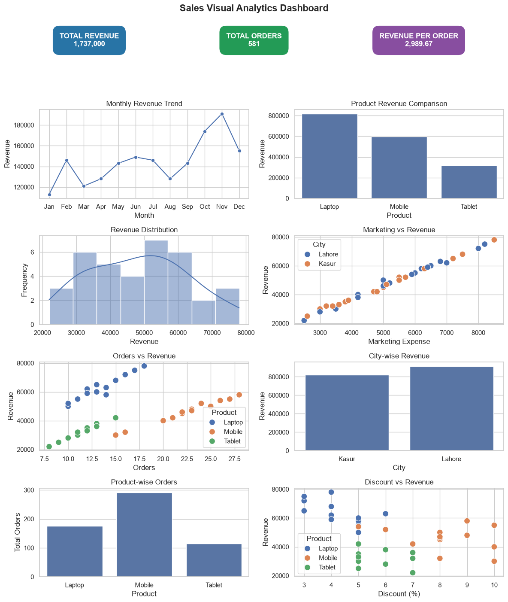
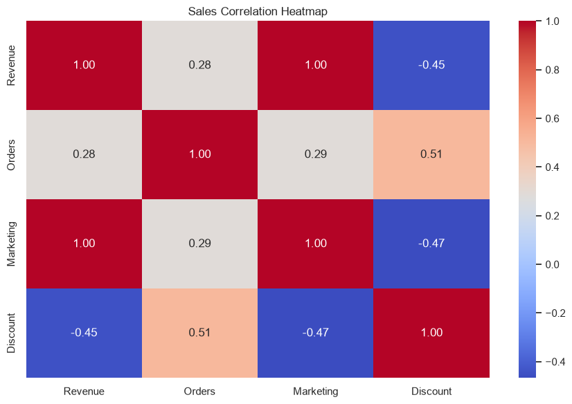

# Sales Visual Analytics Dashboard

A Python-based data analytics project that analyzes sales data and creates visual dashboards to understand business performance, revenue trends, product sales, city performance, marketing expenses, and discounts.

This project uses a synthetic sales dataset containing 36 records across 12 months.

## Project Objectives

- Analyze monthly sales revenue.
- Compare revenue generated by different products.
- Analyze sales performance across cities.
- Understand the relationship between marketing expenses and revenue.
- Analyze orders and discounts.
- Calculate important business performance metrics.
- Create visual dashboards using Matplotlib and Seaborn.
- Generate useful business insights from sales data.

## Technologies Used

- Python
- Pandas
- NumPy
- Matplotlib
- Seaborn
- Unittest

## Project Features

### 1. Data Analysis

- Create a Pandas DataFrame.
- Inspect dataset information.
- Check missing values.
- Generate statistical summaries.
- Analyze 36 sales records.

### 2. Data Validation

The project includes a reusable validation function to check:

- Required dataset columns.
- Empty datasets.
- Missing values.
- Duplicate records.
- Valid month, product, and city names.
- Valid numeric values.
- Negative revenue, orders, and marketing expenses.
- Whole number orders.
- Valid discount percentages.

### 3. Business Metrics

- Total Revenue
- Total Orders
- Average Revenue
- Revenue Per Order
- Best Performing Month
- Best Performing Product
- Best Performing City

### 4. Data Visualization

The dashboard includes eight visualizations:

1. Monthly Revenue Trend
2. Product Revenue Comparison
3. Revenue Distribution
4. Marketing vs Revenue
5. Orders vs Revenue
6. City-wise Revenue
7. Product-wise Orders
8. Discount vs Revenue

### 5. Correlation Analysis

A separate correlation heatmap is created to explore relationships between:

- Revenue
- Orders
- Marketing
- Discount

### 6. Business Insights

The project identifies the best-performing month, product, and city based on revenue.

It also calculates important sales metrics to help understand overall business performance.

### 7. Automated Testing

The project includes 15 automated tests using Python's Unittest framework.

These tests check data validation, including valid data, empty datasets, missing values, duplicate records, invalid values, and other conditions.

## Project Structure

```text
Sales-Visual-Analytics-Dashboard/
│
├── output/
│   ├── sales_dashboard.png
│   └── correlation_heatmap.png
│
├── tests/
│   └── test_analysis.py
│
├── main.py
├── README.md
├── requirements.txt
└── .gitignore
```

## Dashboard Preview

### Sales Dashboard



### Correlation Heatmap



## Installation and Setup

### 1. Clone the Repository

```bash
git clone https://github.com/JS-JUNAIDSALEEM/Sales-Visual-Analytics-Dashboard.git
```

### 2. Open the Project Folder

```bash
cd Sales-Visual-Analytics-Dashboard
```

### 3. Install Required Libraries

```bash
pip install -r requirements.txt
```

### 4. Run the Project

```bash
python main.py
```

The program generates two visualization files:

- `sales_dashboard.png`
- `correlation_heatmap.png`

## Running Automated Tests

To run all 15 automated tests, use:

```bash
py -m unittest tests/test_analysis.py -v
```

The tests check different data validation conditions and make sure importing `main.py` does not automatically run the program.

## Dataset Information

The project uses a sample synthetic sales dataset created with Python.

The dataset contains 36 records and includes the following columns:

| Column | Description |
|---|---|
| Month | Sales month |
| Product | Product name |
| City | Sales city |
| Revenue | Generated revenue |
| Orders | Number of orders |
| Marketing | Marketing expenses |
| Discount | Discount percentage |

**Note:** The dataset is synthetic and created for educational and analytical purposes. It does not represent actual company sales.

## Learning Outcomes

Through this project, I practiced:

- Python programming fundamentals.
- Pandas DataFrame operations.
- Data inspection and statistical summaries.
- GroupBy and aggregation.
- Data validation and automated testing.
- Data analysis and business metrics.
- Matplotlib visualizations.
- Seaborn charts and heatmaps.
- Exploratory data analysis.
- Business insights and data interpretation.

## Future Improvements

- Use a publicly available real-world sales dataset.
- Add more detailed sales analysis.
- Create an interactive dashboard.
- Add more business performance metrics.

## Author

### Junaid Saleem

- **GitHub:** [JS-JUNAIDSALEEM](https://github.com/JS-JUNAIDSALEEM)
- **LinkedIn:** [Junaid Saleem](https://www.linkedin.com/in/junaid-saleem-developer/)